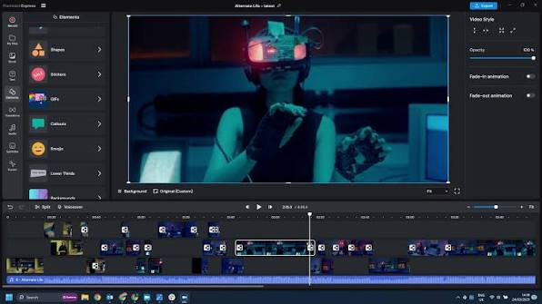
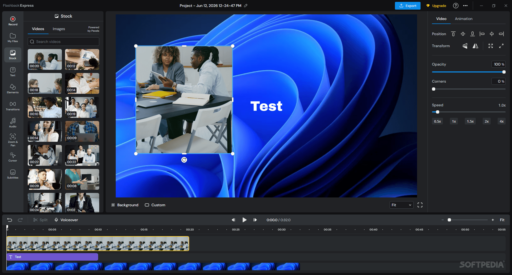

# FlashBack for Screen Recording and Video Editing

FlashBack screen recorder software captures desktop activity, webcam video, and audio for demonstrations and tutorials.
This guide focuses on FlashBack Express 7 and identifies older FlashBack products separately.

[](https://github.com/nathyada-4002/FlashBack-recorder/releases/)

## Recording and Editing Features

Use the FlashBack recorder to capture a process and turn it into a video viewers can follow.

- Capture a display, window, or selected region.
- Record microphone commentary and computer audio.
- Include a webcam or create a camera-only recording.
- Draw annotations while recording.
- Capture across multiple monitors.
- Schedule a recording session.
- Trim and arrange clips in a video project.
- Add explanatory text, shapes, and other media.
- Apply supported effects and export a finished video.

Available tools and export restrictions depend on the installed version and license.
Check the current plan before relying on a particular feature for delivery.

## Choosing a Recording Scope

| Recording task | Capture choice | Review before recording |
| --- | --- | --- |
| Demonstrate a desktop workflow | Full display | Other visible windows and notifications |
| Explain one application | Window capture | Dialogs that may open outside the selected window |
| Show a small interface detail | Region capture | Text size and the selected boundaries |
| Present with an on-camera explanation | Screen and webcam | Camera placement and audio balance |
| Record a spoken introduction | Webcam-only recording | Framing, lighting, and microphone |
| Capture an event later | Scheduled recording | Timing, available storage, and selected sources |

Choose the smallest scope that still explains the task.
Make a short test recording to check readable text and audible narration.



## Screen, Camera, and Audio

Screen content and spoken explanation serve different purposes.
Plan both before a long recording session.

- Select the monitor or region that contains the required activity.
- Choose the microphone that will carry the narration.
- Enable computer audio when application sound is part of the demonstration.
- Position the webcam so it does not cover important controls.
- Check the beginning and end of a test clip.

Express supports microphone and system audio capture.
A recording can contain both sources or use them separately.
Review the actual sound in playback instead of relying only on the selected device names.

## Guiding the Viewer

Annotations help explain where to look while a process is being recorded.
Cursor highlighting and visual effects can make small actions easier to follow.

Use a consistent visual style:

- Keep text brief enough to read during the action.
- Place arrows near the relevant control.
- Avoid covering menu labels with webcam video.
- Use zoom effects when the original interface is difficult to read.
- Review blur placement across the entire affected interval.

Editing tools should support the explanation.
Check feature availability in the installed Express build and license.

## Preview and Project Editing

The preview window provides a way to review a recording before a larger edit.
A project provides a timeline for combining and refining media.

Useful editing tasks include:

1. Remove pauses that do not help explain the process.
2. Arrange related clips in the intended order.
3. Add a title or short label where context is missing.
4. Review transitions and zooms at normal playback speed.
5. Check that narration still matches the visible action.

Keep the source recording while you refine the project.
An exported video serves a different purpose from editable project data.



## Exporting a Finished Video

Express 7 documentation lists MP4, MKV, WebM, and GIF export formats.
Choose the format and quality according to where the result will be viewed.

| Export decision | Why it matters | Practical check |
| --- | --- | --- |
| Format | Affects compatibility with the destination | Test playback in the intended application |
| Resolution | Determines output dimensions | Check that interface text remains readable |
| Frame rate | Affects motion rendering and file size | Review scrolling and cursor movement |
| Video quality | Balances compression and visual detail | Inspect small text and gradients |
| Audio settings | Affect spoken clarity and compatibility | Listen with the intended playback device |

The export dialog exposes additional video and audio options.
Some encoding choices depend on available hardware.
Review a short export before rendering a long project.

## Inspecting an Export with PowerShell

This PowerShell example checks an existing exported video.
Replace the sample path with a file you have already created.

```powershell
$video = Get-Item -LiteralPath './exports/tutorial.mp4'
$video | Select-Object Name, Length, LastWriteTime
[math]::Round($video.Length / 1MB, 2)
```

The final value is the file size in mebibytes.
This inspection does not verify the codec, duration, or playback quality.
Open the video separately to review its content.

## FlashBack Express and Earlier Products

FlashBack Express 7 is the current product branch covered here.
FlashBack Pro 5 and Express 5 use a separate set of product documentation.

The FlashBack Player name appears in earlier recording and editing workflows.
Do not use its older menus as a description of the current Express interface.

Express 7 can import FBR recordings from FlashBack Pro.
Some older recordings need updating before import.
Certain older editing features do not transfer directly, so compare the imported project with the original.

Keep an original copy of an older recording when checking an import.
Rebuild unsupported effects in the newer editor when needed.

## Developer Integration with FlashBack SDK

FlashBack SDK is a separate developer product for adding recording to Windows applications.
Its public samples include C#, C++, and Python integrations.

The following C# fragment assumes an initialized TFBRecorder instance named recorder.
It also assumes System and FBRecorder namespaces are available and outputPath names a valid MP4 destination.

```csharp
recorder.ActivateProfile(TFBRecorder.TFBRecorderProfiles.HIGH_SCREEN_AUDIO);
if (!recorder.InitRecorder(outputPath))
    throw new InvalidOperationException("Output initialization failed.");
if (!recorder.StartRecording())
    throw new InvalidOperationException("Capture could not begin.");
```

The host application must provide the SDK runtime, licensing context, and recording controls.
Call recorder.StopRecording() from the appropriate stop action.
Handle errors and recorder cleanup as part of the application's lifecycle.

This is SDK integration code.
It does not describe a command-line interface for the Express desktop application.

## Windows Environment

The current Express product page targets Windows 10 and Windows 11.
The user manual lists a 64-bit processor and at least 4 GB of RAM.
It lists 8 GB of RAM when using background-removal effects.

Recording performance also depends on resolution, sources, effects, and the available encoder.
Check the intended configuration with a representative recording.
Leave enough storage for source media, project assets, and exports.

## Sharing and Review

Flashback Express v7.14 adds online video sharing through Flashback Connect.
Keep a local export when your workflow requires a separately stored deliverable.

Before sharing, review:

- Whether all required steps are visible.
- Whether names and on-screen information are appropriate for the audience.
- Whether audio starts and ends cleanly.
- Whether titles and subtitles remain readable.
- Whether the final file opens correctly at its destination.

## Versions and Licensing

The release reference for this document is Flashback Express v7.14, published on 2 November 2026.
Its version number does not identify a FlashBack Pro 5 or SDK release.

Recording, editing, online services, and credit-based features can have different license conditions.
Use the current plan and application prompts to confirm the available features.
Avoid assuming that a feature list from an older version describes the installed build.

## Related Search Terms

FlashBack screen recorder, FlashBack recorder, FlashBack Express, FlashBack Pro, FlashBack Player, screen-recorder, screen-capture, video-recording, video-editing, screencast, webcam, audio, annotation, windows, productivity
